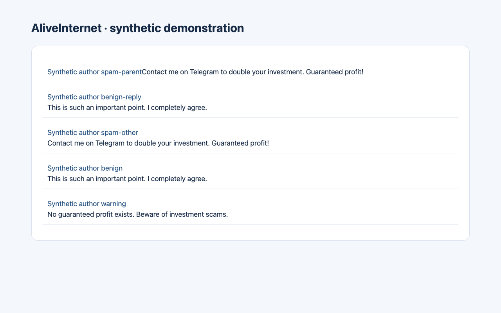

# AliveInternet

**An open-source, privacy-first browser extension for reducing social spam, suspicious promotions and unwanted artificial engagement.** Think of content blocking with explainable evidence, transparent user controls, and modular OSINT research tools.



*Synthetic content, actual production extension. [Media provenance](docs/media/README.md).*

> **Status: v0.3 alpha.** Chrome, Firefox and Edge MV3 compile; the production extension has isolated Chromium and temporary Firefox desktop fixture coverage. Site consent, settings backup/restore, reversible hiding and current-tab hidden-item review are implemented. Live-platform coverage remains provisional; this is **not** a verified bot detector. See the [completion evidence](docs/completion-report.md) for measured results and remaining dependencies.

Latest verification: [October 13 release evidence](docs/release-readiness.md) adds signed-app checks, 15 integration groups in each branded Chrome/Edge browser, repeated off/on benchmarks on the available Mac, and a licensed historical YouTube corpus. The rules collapsed **0 of 810 source-labelled spam comments** in that transformed corpus. Broad spam-detection claims remain unsupported; signed Firefox, privacy mailbox delivery and store publisher verification are still pending. The maintainer-approved source is public and the [privacy policy](https://rishixgamer.github.io/AliveInternet/privacy/) is hosted and verified.

## What works in the source

| Capability | State |
|---|---|
| Local manual account hiding (posts + comments) with reversible UI | Implemented; serialized mutations, multi-tab delivery and worker restart tested in Chromium fixtures |
| Conservative spam/scam heuristics and optional evidence annotations | Implemented, not benchmark-calibrated |
| Optional long lexical near-duplicate comment collapsing | Implemented, enabled **off** by default |
| Personal mute words and per-site account allowlists | Implemented popup editors and serialized saves; source regressions and Chromium preference integration |
| Large-page processing beyond 350 items | Implemented; 1,401-item Chromium fixture; repetition/account context limited to each batch |
| Visible-page account evidence inspector | Implemented; broader live usability checks pending |
| Site activation with browser consent | YouTube required access; nine other sites optional, requested only on explicit activation |
| Settings backup and restore | Local download, bounded preview, cancel, merge or confirmed full replacement; no permission grants during import |
| Hidden on this page | Ephemeral current-tab review, 50-item pagination and temporary reveal |
| Reusable core package | Built and packed locally as standalone offline ESM with declarations; unpublished |
| Manual JSON public-indicator pack import and exact match advisory | Implemented, **off** by default |
| Exact public domain matching, no unverified domain-to-person attribution | Implemented, tests pass |
| Local/offline shared-domain campaign candidate graph extraction | Implemented CLI and optional offline viewer |
| Manual opt-in RDAP domain metadata lookup | Implemented CLI, requires internet |
| Cross-platform adapters for YouTube, X, Instagram, Reddit, TikTok, Facebook, Threads, Bluesky, LinkedIn, Twitch | Experimental (see below) |
| EmbeddingGemma 2 semantic similarity | Node proof of concept only; **not in browser filtering** |
| Signed community threat feeds, semantic multilingual detection, multimodal slop filters, full coordination graph, real-time domain reputation | Research/design only; **not built** |

### Planned (groundwork in the repo, not active)

Store listings · toolbar hidden-count badge · shareable monthly stats card · community rule-list import and language packs · "report a miss / wrongly hidden" · representative scam benchmark data · evaluated reply-chain, creator-impersonation, copied-comment and profile-bait detection · opt-in generic-comment filter · on-device classifier · verified creator/pinned/hearted adapter flags · creator mode · link-destination UI · look-alike brand domains · fake verification badges · YouTube live chat and Twitch chat-specific handling · fake giveaway livestreams · moderator export UI · npm publication · right-click "check this comment" · per-channel strictness · translated interface · supply-chain hardening · scam-pattern-of-the-week changelog. Pure helpers for several features already exist; see [feature groundwork](docs/feature-groundwork.md) and [good first issues](docs/good-first-issues.md).

**The project never verifies that an individual account is a bot.** It identifies observable suspicious behavior, gives users reversible local filtering, and surfaces limited, cited investigative signals. Browser hiding does **not** delete posts, ban accounts, alter platform account settings or act as a server-side moderator.

### Platforms

| Site | Feed / posts | Comments | Account identity | Readiness |
|---|---|---|---|---|
| YouTube | Video cards, community posts | Parent comments and expanded replies | Public profile URL | Chromium fixtures + one anonymous live watch-page and 10-reply attribution smoke; broader coverage provisional; default on |
| X / Twitter | Tweets / replies | Part of tweet cards | Public profile URL | Experimental, default off |
| Instagram | Caption selector | Provisional | Public profile URL | Experimental, default off |
| Reddit | Posts | Comments | Public profile URL | Experimental, default off |
| TikTok | Video descriptions | Provisional | Public profile URL | Experimental, default off |
| Facebook | Feed | Not yet | Public profile URL | Experimental, default off |
| Threads | Feed | Not separately | Public profile URL | Experimental, default off |
| Bluesky | Feed | Not separately | Public profile URL | Experimental, default off |
| LinkedIn | Feed | Provisional | Public profile URL | Experimental, default off |
| Twitch | Stream cards | Live chat (provisional) | Public channel URL; chat usernames usually unlinked | Experimental, default off; selectors unverified |

The extension works only in supported **browser** pages. A matched selector is not proof the site works with its current interface. **It does not filter native mobile apps.**

## Quick start

Requirements: Node.js >= 22.16, npm, Chrome/Chromium, and network access for dependencies.

```sh
npm ci
npm test
npm run typecheck:core
npm run typecheck
npm run build          # Chrome; also build:firefox, build:edge, build:all
```

For isolated production-extension checks, run `npx playwright install chromium` once, then `npm run test:browser`. `npm run test:package` verifies the packed core in a fresh consumer. Run `npx playwright install firefox` once and `npm run test:firefox` for isolated temporary Firefox desktop execution. The optional `npm run test:live` visits one anonymous public YouTube page, expands one reply group and saves aggregate evidence only. `npm run benchmark` exercises the local synthetic evaluation fixture; it is not accuracy calibration.

Then go to `chrome://extensions`, enable Developer mode, select **Load unpacked**, and choose `.output/chrome-mv3`. Use the popup to select websites, filtering strength, individual account hiding, opt-in duplicate hiding, and OSINT annotations. Every content collapse has a **Show temporarily** button. Use the popup blocklist to undo local account hides. Enable optional sites explicitly to request their host access, then reload tabs opened before the grant. The popup also provides settings backup/restore and an explicit current-tab hidden-item review. An imported site preference alone grants no access.

`npm run dev` uses WXT development mode. Check the installed extension permissions and test each site's adapter manually before using it regularly.

## OSINT / network tools

**No OSINT web request is made by the browser extension.** Public indicator packs are imported explicitly from local JSON, length-validated, and matched only against exact on-page account keys / URL hostnames. **Matches are advisory only.** Imported publisher and evidence metadata are not cryptographically verified and must not be treated as authoritative.

- [Example synthetic indicator pack](docs/indicator-pack.example.json): use the popup's JSON import control; toggle on **OSINT indicator advisories** to display potential exact matches.
- `npm run investigate:fixture`: analyzes a bundled **synthetic** dataset in local memory and prints account observations, shared-domain candidate groups, and evidence-labelled graph JSON. `npm run investigate:fixture -- path/to/permissioned.json` accepts a local JSON file (<=2 MB, <=500 entries). This is investigative context, not proof of bots.
- [Offline graph viewer](tools/network-viewer.html): open locally in a browser, save the prior report to JSON, and load it to inspect edges without uploading anything.
- `npm run intel:rdap -- example.com`: manual domain registration metadata lookup, not IP/location attribution. This command uses a public RDAP service and transmits the requested domain; it is **never** called automatically.

**No geographic-proximity risk model**: publicly attributed campaign origins can be researched at the *campaign* level with citations. An individual's apparent country, language, claimed location, or proximity to documented operations is not used as evidence of automation or spam.

## Project map

```text
entrypoints/                 WXT content script, popup and local settings background writer
src/adapters/platforms/     One DOM spec per social platform
src/core/                   Spam rules, deduplication, account observations, policy, embedding ports
src/extension/              Local settings, reversible DOM UI and event controller
src/intel/                  Exact-match provenance-aware indicator packs and enrichment ports
src/network/                Shared-domain campaign candidates and evidence-labelled graph DTO
src/research/               Classification evaluation metrics, benchmark dataset types
src/detectors/              Scaffolded analyzers (reply chains, impersonation, ...); inert
src/rules/                  Community rule-list schema (scaffolded)
src/feedback/  src/creator/ src/ml/   Report drafts, creator mode, on-device classifier ports (scaffolded)
rules/  benchmark/          Community rule lists and benchmark datasets (empty / examples)
src/lib.ts  packages/core/   Built local npm entry point for the offline detection core
locales/                    Staged UI translations (not yet in the build)
scripts/                    Offline fixture analysis, opt-in RDAP, EmbeddingGemma research
fixtures/                   Synthetic content only
tools/                      Offline network graph viewer
AGENTS.md / CLAUDE.md       Agent policy and division of work
```

Refer to [architecture v0.3](docs/architecture-v0.3.md), [roadmap](docs/roadmap.md), [privacy](docs/privacy.md), [model research](docs/model-research.md), and [agent backlog](docs/agent-backlog.md).

## Development with Claude Code, Codex, and local Qwen

Shared invariants are in `AGENTS.md`; `CLAUDE.md` covers Claude workflows. Separate worktrees/PRs by subsystem, for example `src/adapters/platforms/` versus `src/intel/` versus `src/network/`, and require tests and live browser screenshots before marking platforms supported.

## Privacy, safety, and contributions

- Local-only content processing, no telemetry or default backend; content bodies and graph research are not persisted by the extension.
- The browser stores only preferences, local account-block identifiers, and **explicitly imported** advisory pack data.
- No demographic, nationality, geography, political viewpoint, linguistic identity, or inferred physical-location classifiers.
- Account relationships are hypotheses with specific evidence labels, not inferred common ownership or real-world identity.
- No unauthorized scraping, private-message access, cookies, platform moderation API writes, or remote code execution.
- Signed feeds, model weights, server analysis, threat-data updates and optional APIs require explicit review and opt-in.

[Contributing](CONTRIBUTING.md) · [Security](SECURITY.md) · [Threat model](docs/privacy.md) · Apache-2.0 source license (external model weights have separate terms).
